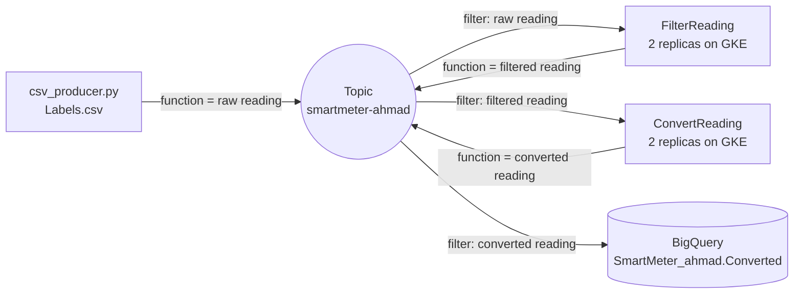

# Milestone 4: Microservices using Google Pub/Sub (Design)

**Student:** Ahmad Musleh (101042609)  
**Course:** SOFE4630U, Software Development Methods and Tools

The design part implements the smart meter preprocessing from Milestone 3 as two **containerized microservices** on GKE instead of a Dataflow job. All the services communicate through **one Pub/Sub topic** (`smartmeter-ahmad`). Each service receives only its own messages through a **filtered subscription** on the message attribute `function`, and a **BigQuery subscription** stores the final results in a table automatically.

## Architecture



| Subscription | Filter | Used by |
|---|---|---|
| `smartmeter-ahmad-filter-sub` | `attributes.function="raw reading"` | FilterReading |
| `smartmeter-ahmad-convert-sub` | `attributes.function="filtered reading"` | ConvertReading |
| `smartmeter-ahmad-bq-sub` (BigQuery subscription) | `attributes.function="converted reading"` | writes to `SmartMeter_ahmad.Converted` |

## Microservices

- **FilterReading** (`filter_reading/main.py`): receives the raw readings. If temperature, humidity and pressure are all present, it publishes the reading again with `function="filtered reading"`. Otherwise the reading is dropped.
- **ConvertReading** (`convert_reading/main.py`): receives the filtered readings, converts `P(psi) = P(kPa) / 6.895` and `T(F) = T(C) * 1.8 + 32`, and publishes the result with `function="converted reading"`.
- **BigQuery subscription**: Pub/Sub writes every converted reading into the table `SmartMeter_ahmad.Converted` (`--use-table-schema`), so no extra code is needed to store the results.

The services create their own filtered subscription the first time they start, and read the project, topic and subscription IDs from environment variables set in `design.yaml`. They need no data storage, so they are stateless and can be scaled by changing the number of replicas.

## Files

| Path | Description |
|---|---|
| `filter_reading/`, `convert_reading/` | `main.py` and `Dockerfile` of each microservice |
| `design.yaml` | GKE deployments of the two microservices (2 replicas each) |
| `csv_producer.py`, `Labels.csv` | Publishes the 100 readings with `function="raw reading"` |
| `scripts/` | `setup_gcp.sh` (APIs, service account, repository, topics, BigQuery subscription, cluster), `deploy_voting.sh`, `deploy_design.sh`, `cleanup.sh` |
| `voting_system/` | The voting system from the lab, adapted to this project (see below) |

## How to run (Cloud Shell)

```bash
git clone https://github.com/ahmadmusleh-26/MS4-Design.git && cd MS4-Design
bash scripts/setup_gcp.sh       # one time
bash scripts/deploy_design.sh   # build, push and deploy the two microservices
kubectl get pods                # wait until they are Running
python csv_producer.py          # publish the 100 readings
bq query --use_legacy_sql=false 'SELECT COUNT(*) FROM SmartMeter_ahmad.Converted'
bash scripts/cleanup.sh         # delete the GKE cluster when done
```

## Changes to the lab code (voting system)

- **No key file:** the organization policy blocks service account key creation. The services use a key only if one exists; otherwise they use the GKE node service account (`gke-ahmad`, roles: Pub/Sub Editor, Artifact Registry Reader, Kubernetes Engine Default Node Service Account). The `COPY *.json` line was removed from the Dockerfiles. The voting machine and the producer run in Cloud Shell with the user's credentials.
- **Unique names:** the GCP project is shared with another student, and the services reuse an existing subscription with the same name. So the topic and all subscriptions have the `ahmad` suffix (for example `election-ahmad`, `election-ahmad-submit-sub`).
- **Redis image:** the official `redis:7-alpine` image with `--requirepass election` is used instead of `bitnami/redis`.
- **PostgreSQL client:** `psycopg2-binary` is installed, so no compiler is needed in the image.

## Discussion: Dataflow vs microservices for preprocessing the smart meter readings

**Dataflow advantages**
- Fully managed and autoscaled: the workers, scaling, retries and monitoring are handled by the service.
- The whole processing is one pipeline in one script, with a job graph and metrics per stage.
- Built for large data: the same code runs in batch and streaming mode, and supports windows, grouping and joins (Reduce-style operations).

**Dataflow disadvantages**
- Slow to start (several minutes to create the workers) and costly for a small, steady stream, since a streaming job keeps at least one worker running.
- Less flexible: every stage must be written with Apache Beam, and changing one stage means redeploying the whole job.

**Microservices advantages**
- Each service is small, independent and can be updated, scaled (replicas) or written in a different language without touching the others.
- Loose coupling through one topic and attribute filters: a new service can be added by creating a new filtered subscription, and no IP addresses are needed.
- Fast to start, and cheap for simple per-message work (filtering and converting need no grouping).

**Microservices disadvantages**
- More to manage: Docker images, a registry, a GKE cluster, deployments and permissions.
- No built-in pipeline view; tracing a message through several services is harder.
- Every hop goes through Pub/Sub again (more messages and latency), there is no ordering or exactly-once guarantee by default, and Reduce-style operations (grouping, windows) must be built by hand.

**Conclusion:** for this simple per-reading preprocessing, both work. Microservices are lighter and more flexible, while Dataflow is the better choice when the processing needs aggregation, very large data, or less infrastructure to manage.
