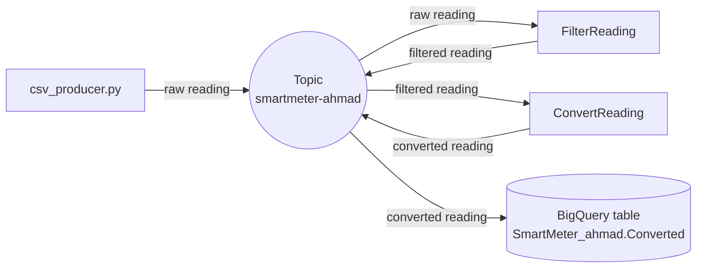

# Milestone 4: Microservices using Google Pub/Sub (Design)

**Student:** Ahmad Musleh (101042609)  
**Course:** SOFE4630U, Software Development Methods and Tools

The smart meter preprocessing from Milestone 3 is done here with two small **microservices** on GKE instead of a Dataflow job. All the services use **one Pub/Sub topic** (`smartmeter-ahmad`). Each message has an attribute `function`, and each service receives only its own messages through a **filtered subscription**. A **BigQuery subscription** saves the final results in a table.

## How it works



1. **csv_producer.py** sends the 100 readings from `Labels.csv` with `function="raw reading"`.
2. **FilterReading** drops a reading if temperature, humidity or pressure is missing (`None`). Otherwise it sends it with `function="filtered reading"`.
3. **ConvertReading** converts `P(psi) = P(kPa) / 6.895` and `T(F) = T(C) * 1.8 + 32`, and sends it with `function="converted reading"`.
4. The **BigQuery subscription** writes every converted reading into `SmartMeter_ahmad.Converted`.

**Result:** 100 readings sent, 22 dropped, 78 rows in BigQuery.

## Files

| Path | Description |
|---|---|
| `filter_reading/` | FilterReading service (`main.py`, `Dockerfile`) |
| `convert_reading/` | ConvertReading service (`main.py`, `Dockerfile`) |
| `design.yaml` | Runs 2 copies of each service on GKE |
| `csv_producer.py`, `Labels.csv` | Sends the readings |
| `voting_system/` | The voting system from the lab, with small changes (below) |
| `scripts/` | Helper scripts (variables, setup, deploy, cleanup) |

## How to run (Cloud Shell)

```bash
# 1. Topic, BigQuery table and BigQuery subscription
gcloud pubsub topics create smartmeter-ahmad
bq --location=northamerica-northeast2 mk --dataset $PROJECT:SmartMeter_ahmad
bq mk --table $PROJECT:SmartMeter_ahmad.Converted time:FLOAT,profileName:STRING,temperature:FLOAT,humidity:FLOAT,pressure:FLOAT
gcloud pubsub subscriptions create smartmeter-ahmad-bq-sub --topic=smartmeter-ahmad \
  --bigquery-table=$PROJECT:SmartMeter_ahmad.Converted --use-table-schema --drop-unknown-fields \
  --message-filter='attributes.function="converted reading"'

# 2. Build, push and deploy the two services
docker build filter_reading -t $REPO/filter-reading && docker push $REPO/filter-reading
docker build convert_reading -t $REPO/convert-reading && docker push $REPO/convert-reading
PROJECT=$PROJECT FILTER_IMAGE=$REPO/filter-reading CONVERT_IMAGE=$REPO/convert-reading envsubst < design.yaml | kubectl apply -f -

# 3. Send the readings and check the table
python csv_producer.py
bq query --use_legacy_sql=false 'SELECT COUNT(*) FROM SmartMeter_ahmad.Converted'
```

The Pub/Sub service agent needs the **BigQuery Data Editor** role to write to the table.

## Changes to the lab code (voting system)

- **No key file:** the account blocks service account keys, so the services use the GKE node service account instead, and `COPY *.json` was removed from the Dockerfiles.
- **Unique names:** the project is shared with another student, so all names end with `ahmad` (for example `election-ahmad`).
- **Redis image:** `redis:7-alpine` is used instead of `bitnami/redis`.
